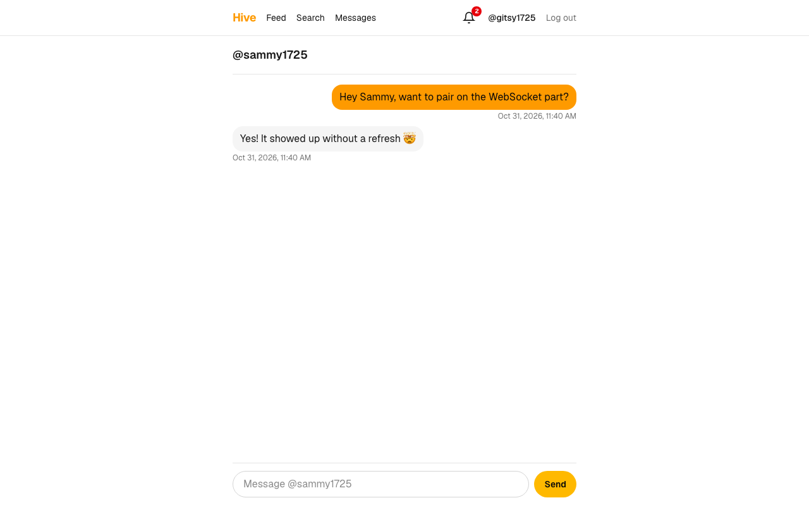

# Hive: a very basic social app, built with Claude Code

[](https://github.com/gitship-sauce/hive/actions/workflows/ci.yml)

Posts and a feed, follow and unfollow, search, live messages and notifications. It was built from an empty folder
with Claude Code, one small task at a time, and every task has tests.



- **Sign up and log in** with a username and password
- **Post** up to 280 characters; your **feed** shows you and the people you follow
- **Profiles** with follow and unfollow
- **Search** people by username
- **Messages** that arrive **live** over a WebSocket, no refresh
- **Notifications**: a live bell, plus **push notifications** through Firebase that show up even when Hive is closed

## Start it (3 commands)

You need [Docker Desktop](https://www.docker.com/products/docker-desktop/) running.

```bash
git clone https://github.com/gitship-sauce/hive.git && cd hive
cp .env.example .env
docker compose up --build
```

Open http://localhost:3000, sign up, then open a private window and sign up as a second person to message yourself.
Push notifications stay off until you do [Turn on push](#turn-on-push-optional); everything else works without it.

Stop it with `Ctrl+C`. Your data stays in a Docker volume; `docker compose down -v` deletes it.

## Work on the code

You need Node.js 24 and Docker Desktop.

```bash
npm install
cp .env.example .env       # if you haven't yet
docker compose up -d db    # only the database, in Docker
npm run db:migrate         # create the tables
npm run dev                # http://localhost:3000, reloads when you save
```

| Command | What it does |
| --- | --- |
| `npm run dev` | Starts the app with live reload (`server.ts`) |
| `npm run check` | Lint, type check and unit tests |
| `npm run e2e` | Browser tests (starts its own dev server on port 3100) |
| `npm run db:generate` | Makes a migration after you change `src/db/schema.ts` |
| `npm run db:migrate` | Applies migrations |
| `npm run build` + `npm start` | Production build and server |

## Tests

```bash
docker compose up -d db
npx playwright install chromium   # once
npm run check                     # lint, types, unit tests
npm run e2e                       # browser tests
```

Tests use a separate database, `social_test`, which Docker creates on its first start, so they never touch your data.
The unit tests run against real Postgres. The browser tests drive real Chrome windows: two users message each other,
follow each other and watch the bell change live. GitHub Actions runs all of it, plus the Docker build, on every push.

## Turn on push (optional)

Push notifications use [Firebase Cloud Messaging](https://firebase.google.com/docs/cloud-messaging), which is free.

1. Go to the [Firebase console](https://console.firebase.google.com/) and **create a project**. Google Analytics isn't needed.
2. In **Project settings → General → Your apps**, add a **Web app** (the `</>` button). Copy its `apiKey`, `authDomain`,
   `projectId`, `messagingSenderId` and `appId` into `.env` as `FIREBASE_API_KEY`, `FIREBASE_AUTH_DOMAIN`, and so on.
3. In **Project settings → Cloud Messaging → Web Push certificates**, press **Generate key pair**. Copy the key into
   `FIREBASE_VAPID_KEY`.
4. In **Project settings → Service accounts**, press **Generate new private key**. Save the file as
   `secrets/firebase-service-account.json` and set `FIREBASE_SERVICE_ACCOUNT_FILE=secrets/firebase-service-account.json`.
   This file is a password for your Firebase project: `.gitignore` keeps it out of git. Never share it.
5. Restart the app, open **Notifications** and press **Turn on notifications**.

To check it: log in as B in one browser and turn push on, then close that tab. As A, follow B. B's computer shows
"New follower". Clicking it opens A's profile.

## How it was built

The video shows this loop. The files are all in the repo:

1. **[PLAN.md](PLAN.md)**: what we want, how we build it (with one reason per choice), the data and the pages,
   written before any code.
2. **[CLAUDE.md](CLAUDE.md)**: the rules Claude follows, for example "one task at a time", "write the test from the
   task's *Done when*, not from your code", "never render user text as HTML".
3. **[tasks.md](tasks.md)**: the tracker sheet. Every task has a *Done when* line a test can check. Things found along
   the way went into **Found while building**, so you can see what really went wrong.
4. For every task: *"Do the next unchecked task in tasks.md."* → Claude plans, codes, writes the tests, runs them,
   ticks the box, and makes one commit. `git log` shows one commit per task.

## How it works

```
Browser ──HTTP──▶ server.ts ──▶ Next.js (pages, server actions)
   │                  │                 │
   └──WebSocket /ws──▶│◀── hub ◀────────┘  "send this to user 7"
                      │
                      └──▶ PostgreSQL (Docker)

Server action ──▶ firebase-admin ──▶ Firebase ──▶ the browser's push service ──▶ notification (tab closed)
```

- **Live updates**: `server.ts` runs Next.js and adds a WebSocket at `/ws` ([src/lib/realtime.ts](src/lib/realtime.ts)).
  A socket opens only with a valid login cookie and only from our own page. When A sends B a message, the server
  action saves it, then pushes it to B's open tabs.
- **Push**: a WebSocket closes with the tab. Firebase push reaches the browser even then
  ([src/lib/push.ts](src/lib/push.ts), [service worker](src/app/firebase-messaging-sw.js/route.ts)).
  Each browser registration belongs to one login, so log out stops pushes to that browser.
- **Safety basics**: passwords hashed with bcrypt, sessions stored as hashes, every input checked with zod on the
  server, every action checks the login itself, and user text is always shown as text, never as HTML.

## Project layout

```
server.ts                 our server: Next.js + WebSocket
src/app/                  pages, server actions, API routes
src/components/           React components
src/lib/                  the app's logic: sessions, posts, follows, messages, notifications, push, realtime
src/db/schema.ts          the tables
drizzle/                  database migrations
tests/                    unit tests (Vitest)
e2e/                      browser tests (Playwright)
```

## If something goes wrong

- **`port is already allocated`**: something else uses 3000 or 5432. Run `APP_PORT=3001 DB_PORT=5433 docker compose up --build`.
  For `npm run dev`, also change the port in `DATABASE_URL` and `TEST_DATABASE_URL` in `.env`.
- **`DATABASE_URL is not set`**: you skipped `cp .env.example .env`.
- **The Turn on notifications button doesn't show**: one of the `FIREBASE_*` values in `.env` is empty.
- **Push doesn't arrive**: check the server log for "Push notifications are off" or a Firebase error, and make sure
  the browser allows notifications for localhost.
